

	
	<h1 align="center">Biblia Bora</h1>

The best bible app with a user-friendly interface,with more than 500 languages, offline access, no ads, and it is completely **FREE**

## v2.0.4-001 (BETA)        ---    (updated on Nov 03, 2026)
### Fixed bugs, new UI, new features, fast search, background music, High quality audio, added new Servers, Multiple Narrators on KJV, NKJV, NIV, ESV, NLT, Swahili, Spanish, Luganda, more to come.
**Not working** verse highlightight, multi-copy, notes with tags, treasure. 

	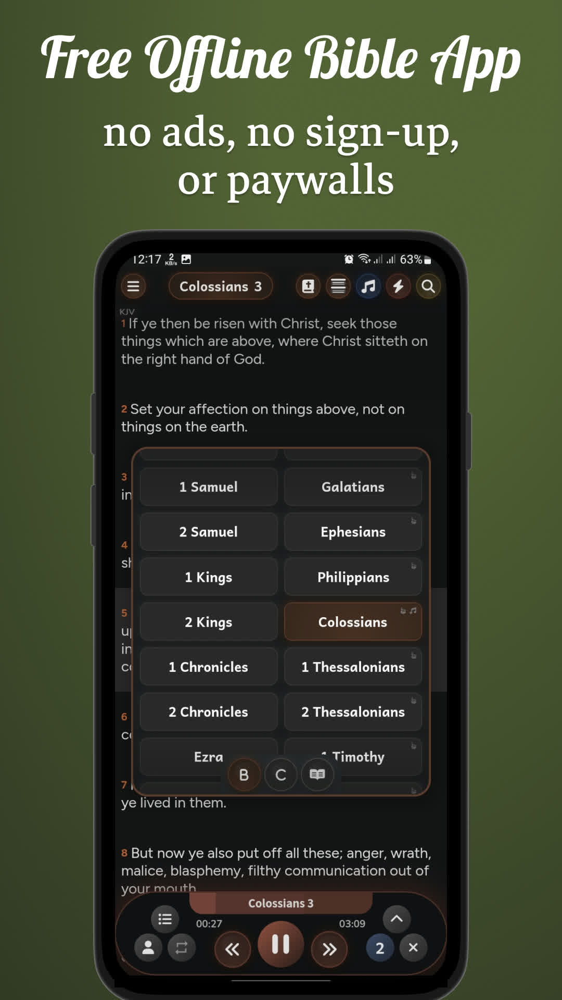
	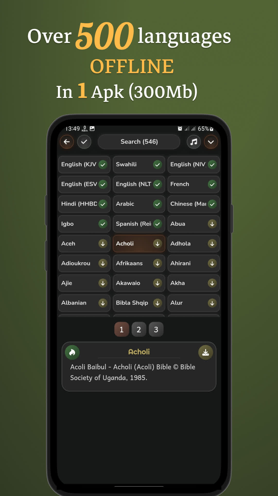
	
	
	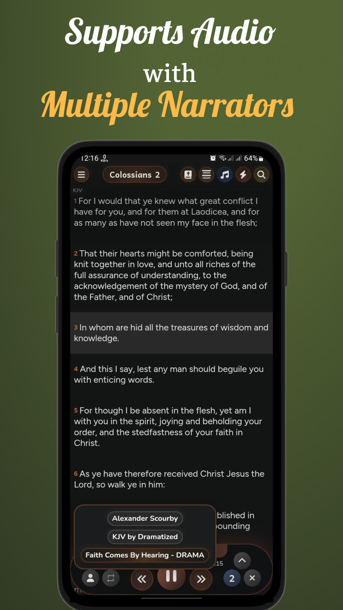
	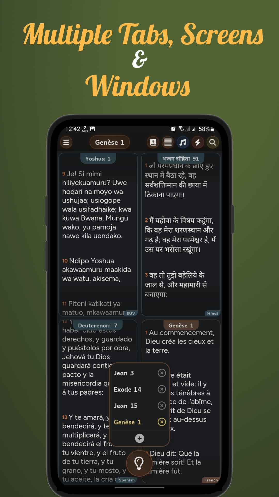
	
	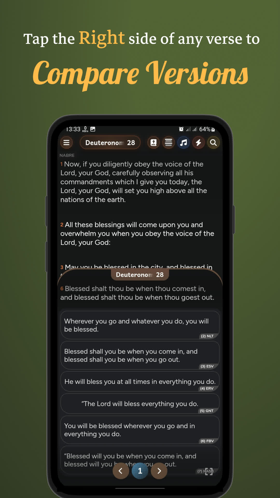
	
	
	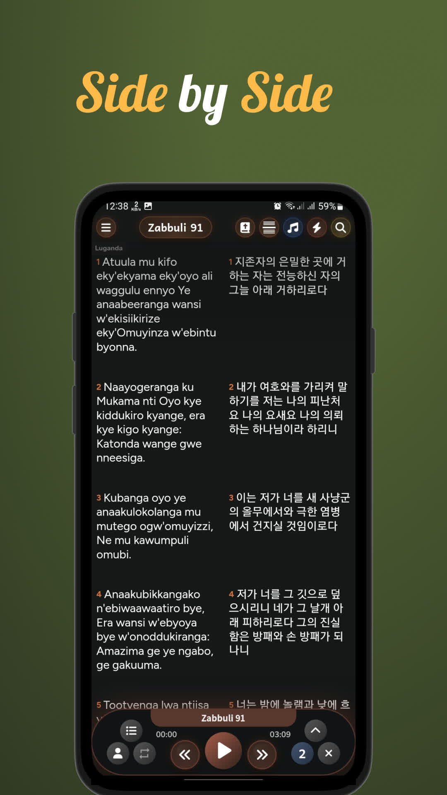
	

With the second button, you can access **500** languages offline without data **(300 MB)** APK.

## v2.0.3 (BETA)        ---    (updated on January 31, 2026)
<!-- ### Improved performance, Fixed Bugs. Added new features, Notes, Compare, Backup & Restore and more.. -->
<!-- ### Improved performance and fixed bugs. added Notes, Compare, Backup & Restore, and other new features are now available. -->
### Fixed bugs, links, added 6000+ topics plus new features.

	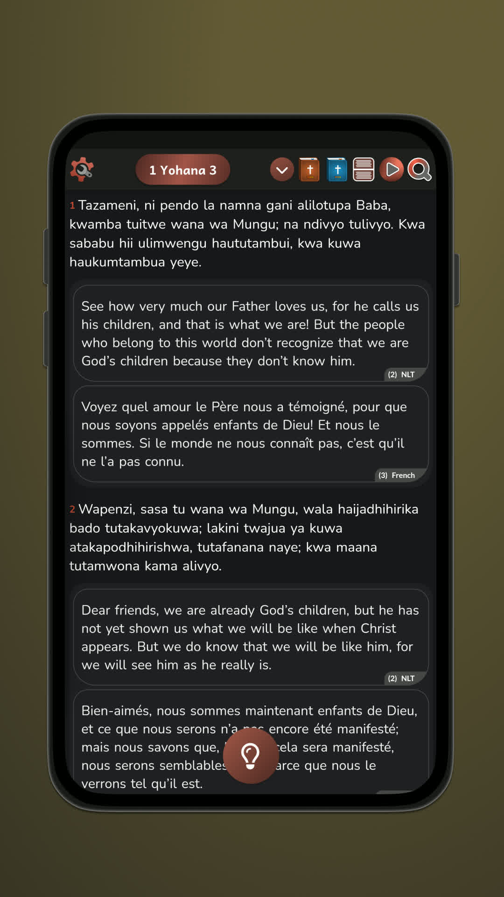
	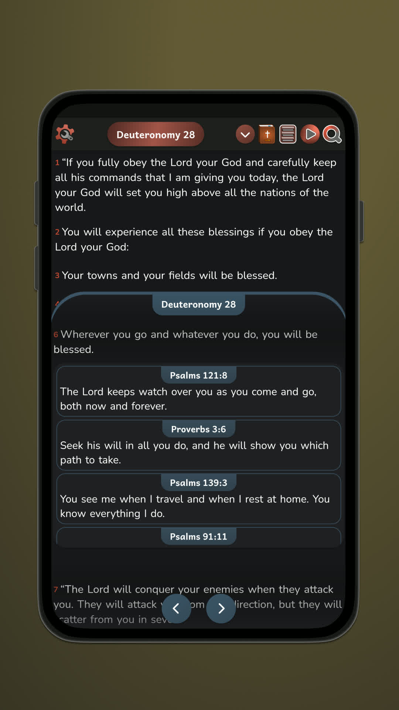
	
	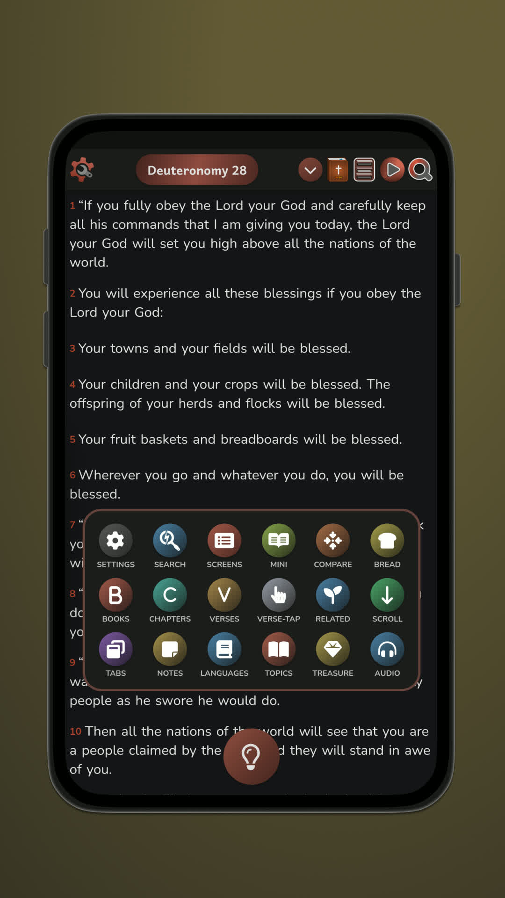
	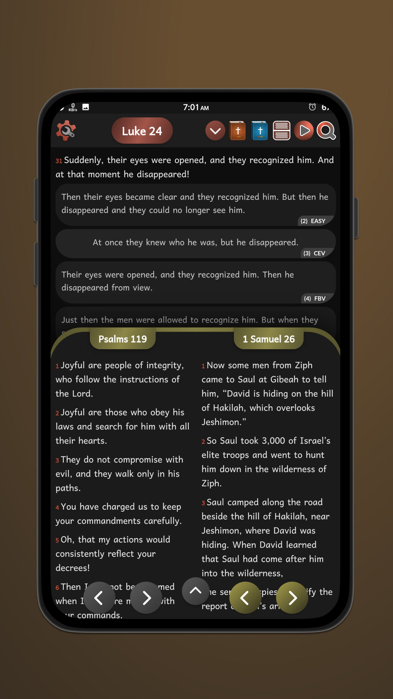
	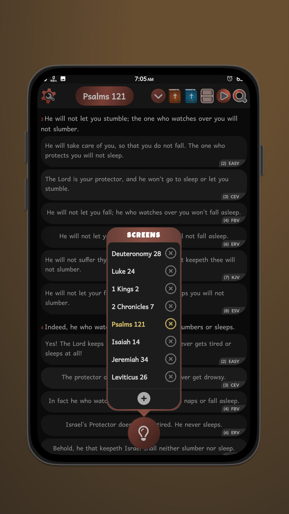

